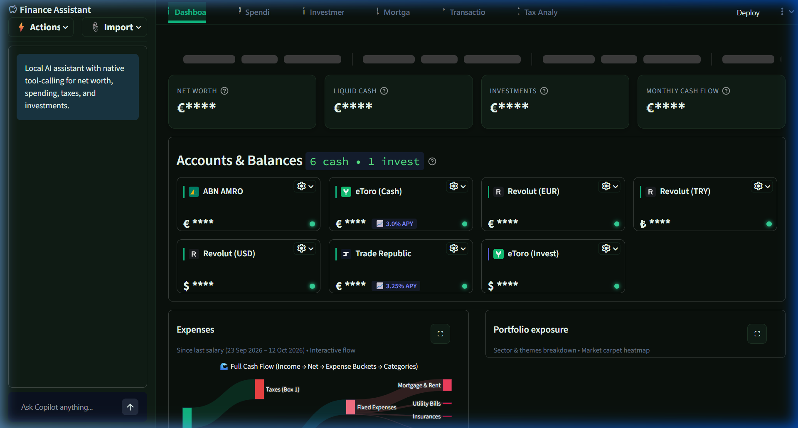
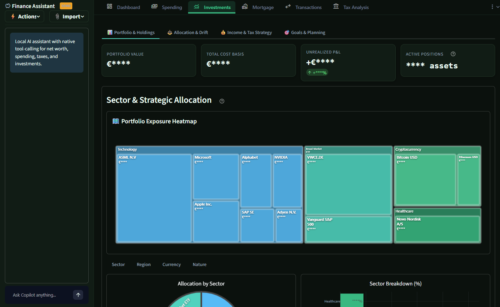
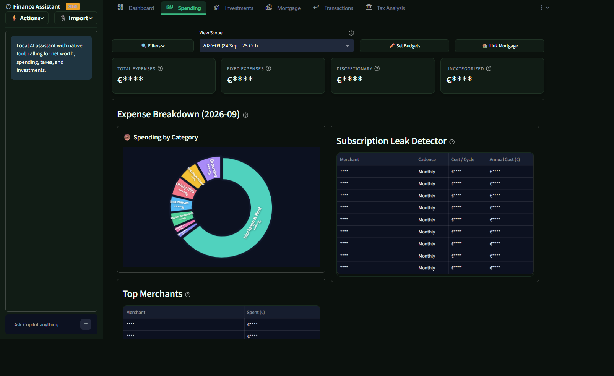
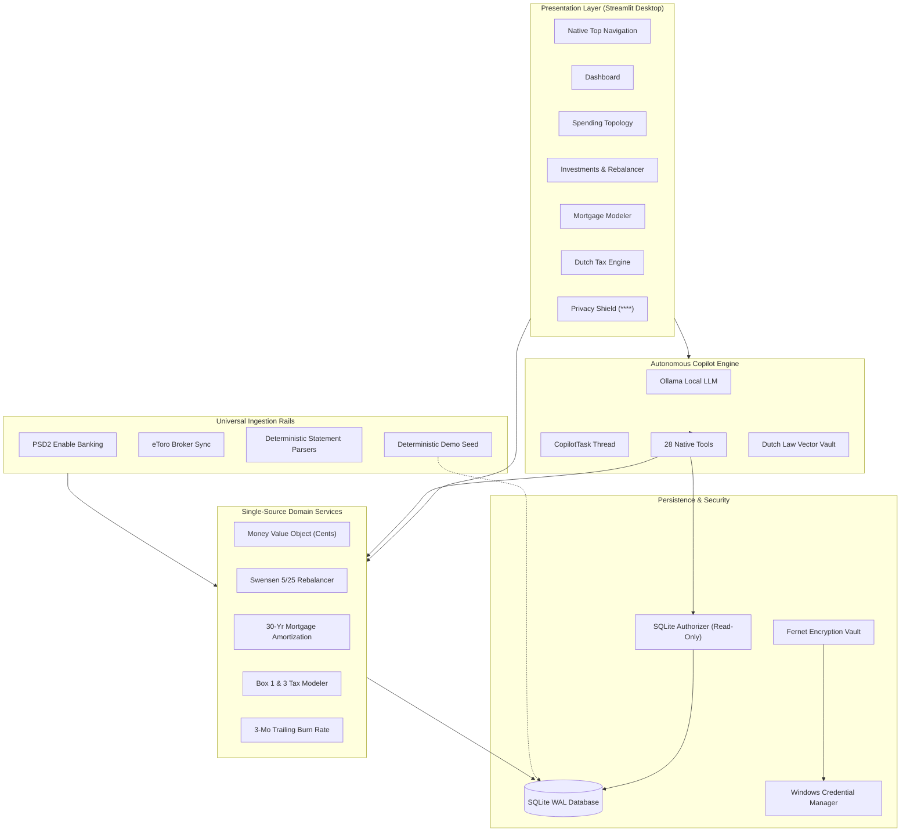
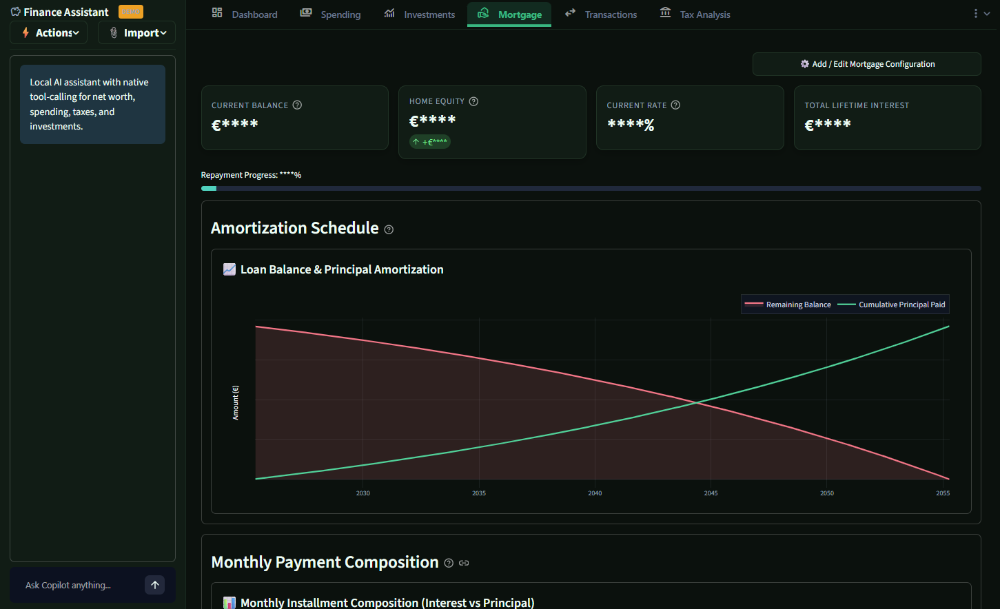
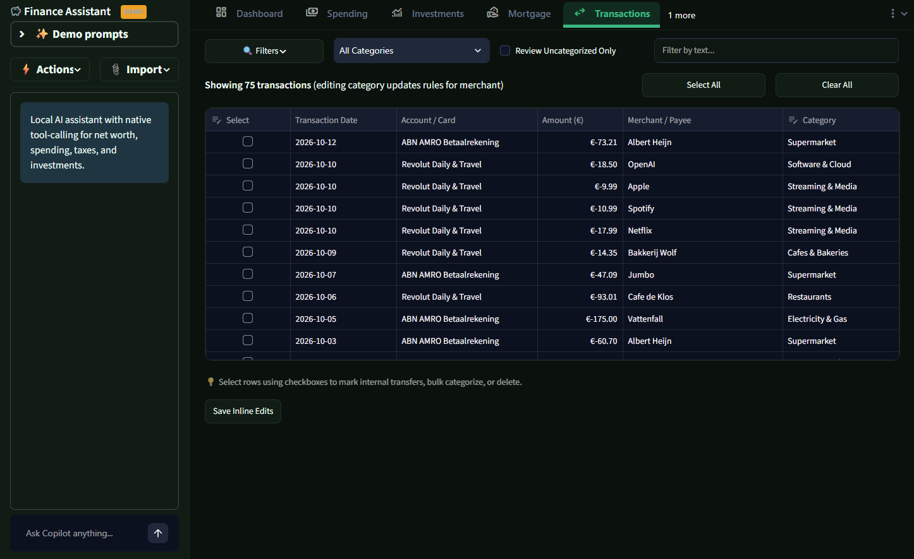
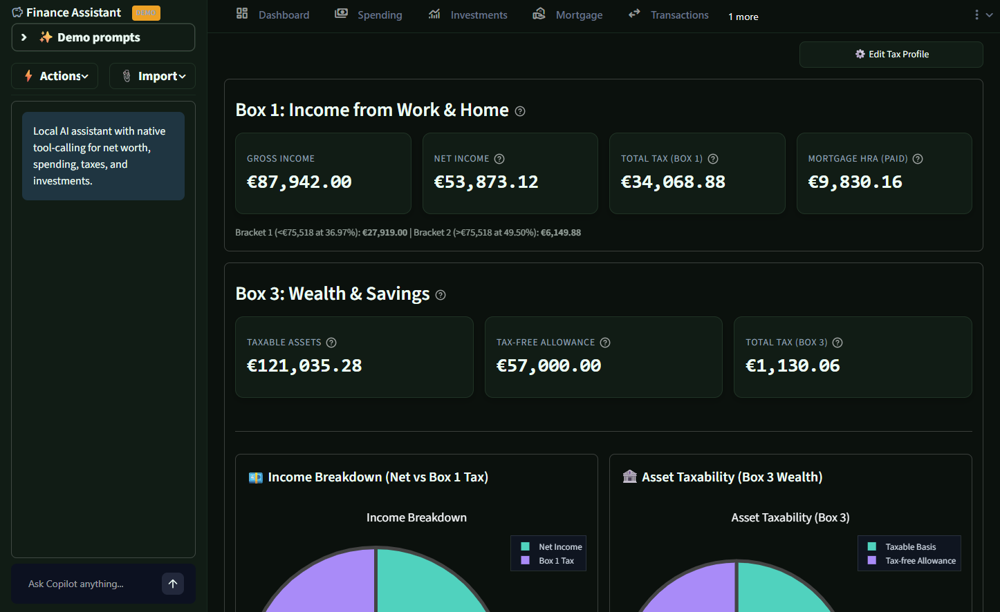
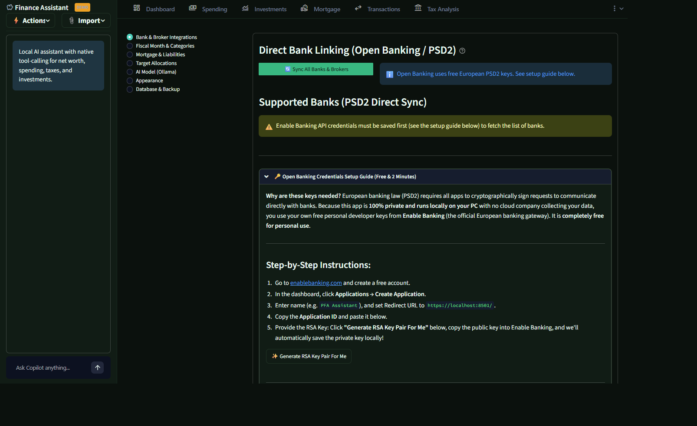

# Personal Finance Assistant (PFA)

[](LICENSE)
[](https://www.python.org/)
[-green.svg)](https://www.sqlite.org/)
[-purple.svg)](https://ollama.com/)
[](tests/)
[](install.ps1)

> **Product Vision**: A high-trust, local-first personal financial operating system built for privacy-conscious European investors and homeowners. Consolidates multi-bank Open Banking feeds, neobroker portfolios, and Dutch mortgage/tax obligations into an interactive desktop interface with an autonomous, offline AI Copilot—**zero cloud custody, zero telemetry, and 100% data ownership.**

<p align="center">
  
  
  
</p>

---

## ⚡ Core Capabilities & Technical Highlights (At a Glance)

| Feature Module | Key Capabilities | Engineering & Architecture Showcase | Stack / Tooling |
| :--- | :--- | :--- | :--- |
| **🤖 Sandboxed AI Copilot** | Offline financial assistant with natural language querying, 28 deterministic tool handlers, and an action layer that opens pages and date scopes. | **Zero-Trust Guardrails**: C-level SQLite Authorizer enforces read only SQL (`SQLITE_SELECT` only). Decoupled non-blocking execution via `@st.fragment` background worker thread. | Ollama (Qwen 2.5), Python `threading`, Streamlit Fragments |
| **⚖️ Dutch Legal Vector Vault** | Semantic search across Dutch tax codes, mortgage deduction laws (*HRA*), and *Groenfondsen* statutory articles with source citations. | **Local Vector RAG & IR**: Persistent SQLite vector store combining dense semantic cosine similarity with FTS5 BM25 keyword search via **Reciprocal Rank Fusion (RRF)**. | `sqlite-vec`, FastEmbed (384-dim CPU), SQLite FTS5 |
| **📈 Quant Portfolio Rebalancer** | Swensen 5/25 threshold drift monitor across multi-asset portfolios with 3 rebalance models (Full, Buy-Only, Target Cash Injection). | **Single Source of Truth Math**: Multi-dimension exposure aggregation (Asset Class, Sector, Region, Currency, Theme), realized P&L tracking for closed positions, and FIRE timeline modeling. | NumPy, Pandas, Plotly, TradingView Widgets |
| **🇳🇱 Belastingdienst Tax Engine** | Dutch Box 1 income tax (with 30% expat ruling & HRA), Box 3 wealth tax deemed yield (*fictief rendement*), and Pillar 3 pension room (*Jaarruimte*). | **Financial Regulatory Modeling**: 4-way capital allocation simulator (Mortgage Prepayment vs. Pension vs. Groenfondsen Arbitrage vs. Taxable ETF) with multi-year trajectories. | Pure Python domain services, Plotly |
| **🏠 Dutch Mortgage Simulator** | 30-year amortization modeling for Annuity (*annuïteit*), Linear (*lineair*), and Interest-Only (*aflossingsvrij*) mortgage structures. | **Loan Analytics & Optimization**: Penalty-free prepayment simulator (*boetevrij aflossen*, up to 10–20%/yr), compound interest savings, and real-time Loan-to-Value (LTV) net equity tracking. | Mathematical amortization algorithms |
| **🔌 Universal Ingestion Rails** | PSD2 Open Banking sync, direct eToro broker sync, bilingual PDF statement parsers (Turkish/English İş Bankası), CAMT.053 XML, and MT940. | **Hybrid Data Pipeline**: Deterministic format extraction with SHA-256 deduplication and graceful fallback to local LLM zero-shot schema extraction for irregular bank exports. | Enable Banking AISP (RSA/RS256 JWT), PyPDF, Regex, Ollama |
| **🔒 Zero-Trust Privacy Shield** | One-click Privacy Shield masks money amounts only (`€****`), keeping tickers, merchant names, categories, counts, and percentages readable for public screen sharing or live streaming. | **Local Security Posture**: Symmetric Fernet secrets encryption; master key stored in **Windows Credential Manager** (`keyring`). Zero cloud telemetry. | Python Cryptography, Windows Credential Manager |

---

## 🧭 Executive Summary & System Topology

Mainstream personal finance aggregators (YNAB, Copilot Money, Monarch) mandate cloud custody of sensitive banking credentials, transmit analytics telemetry, and charge recurring SaaS subscriptions while neglecting localized European regulatory and fiscal frameworks.

**Personal Finance Assistant** rethinks consumer FinTech around **zero-trust local-first execution**:



---

## 🎭 Interactive Demo Mode & Instant Showcase

Test-drive all financial modeling, charts, and copilot tools immediately without connecting bank credentials:

```cmd
run.bat --demo
```

Or run via environment variable:
```powershell
$env:PFA_DEMO = "1"
.\.venv\Scripts\streamlit.exe run app.py
```

- **Isolated & Safe**: Binds to `data/demo.db`. Your live `data/finance.db` and encrypted `data/vault.bin` are **never touched**.
- **Realistic Amsterdam Profile**: Pre-loaded with 18 months of salary and expenses, an active €420,000 mortgage, 15 investment holdings (VWCE, ASML, Novo Nordisk, Microsoft, Bitcoin, Gold) including closed positions with realized P&L, and Belastingdienst 30% ruling tax profiles.
- **Visual Demo Pill**: Clear visual pill badge in the Copilot header indicating demo data is active.
- **Idempotent Reset**: Run `python scripts/seed_demo.py --reset` at any time to re-generate the pristine demo dataset.

---

## 📸 Application Visual Showcase

All visuals captured in **Privacy Shield** mode (`Hide values` ON) ensuring complete confidentiality during demonstrations and presentations:

### 1. Executive Wealth Dashboard & Portfolio Exposure
Comprehensive multi-asset overview tracking net worth trajectory, cash flow trends, account liquidity, and dynamic exposure treemaps:


### 2. Spending Topology & Expense Breakdown
Interactive donut charts, category-level cash flow drilldowns, and automated recurring subscription leak detection:


### 3. Multi-Asset Portfolio Allocation & Drift Engine
Swensen 5/25 threshold rebalancing monitor, dimension switchers (Asset Class, Currency, Geography, Sector), and live TradingView integration:


### 4. Dutch Mortgage & Real Estate Modeler
30-year amortization curve modeling (Annuity, Linear, Interest-Only), penalty-free prepayment simulator, and net home equity tracking:


### 5. Transaction Ledger & Inline Categorization
Searchable transaction records with multi-criteria filtering (date, account, category), sorting, and inline editing workflows:


### 6. Belastingdienst Tax Intelligence (Box 1 & Box 3)
Dutch Box 1 income tax optimization, Box 3 wealth tax deemed yield calculation, and pension room (*Jaarruimte*) arbitrage modeling:


### 7. Settings, Credentials Vault & Database Management
Local SQLite database backups, API secrets vault, bank connections, and classification rules management:


---

## 💡 Strategic Engineering Decisions & Trade-Offs

| Decision | Alternative Evaluated | Engineering & Product Rationale |
| :--- | :--- | :--- |
| **Local SQLite (WAL Mode)** | Cloud PostgreSQL / Supabase | **Zero Data Custody & Microsecond Latency**. Eliminates cloud infrastructure cost, GDPR liability, and vendor lock-in. WAL mode guarantees crash resilience and concurrency. Minor-unit integer storage avoids IEEE 754 float drift. |
| **Local LLM (Ollama) via Native Tools** | OpenAI / Anthropic API Calls | **Uncompromising Privacy**. Financial records are never sent over the wire. Deterministic Python engines handle calculation; the LLM handles semantic routing, reasoning, and commentary. |
| **Engine-Level SQL Authorizer** | Prompt-engineered SQL filtering | **Zero-Trust AI Guardrails**. Read-only access enforced directly at SQLite C-authorizer level (`connect_readonly()`). Any LLM-generated `INSERT`, `UPDATE`, `DELETE`, `DROP`, `PRAGMA`, or `ATTACH` statement is denied by the database engine. |
| **Decoupled Background Threading** | Synchronous Streamlit runs | **Non-Blocking Copilot UX**. LLM turn execution runs in an isolated `CopilotTask` worker thread with `@st.fragment`. UI actions (e.g. toggling privacy mode or navigating tabs) never cancel or crash the assistant. |
| **Hybrid Statement Ingestion Pipeline** | Hardcoded regex parsers only | **Robustness Across Formats**. Deterministic extraction handles structured bank formats (İş Bankası, ABN AMRO, Revolut, CAMT.053); local Ollama zero-shot extraction acts as autonomous fallback for irregular layouts. |
| **OS-Level Keyring Encryption** | Plaintext `.env` configs | **Enterprise Security Posture**. Banking certificates, API secrets, and tokens are encrypted symmetrically with Fernet; master key is stored securely in the Windows Credential Manager. |

---

## 🛠️ Core Functional Modules

### 1. 📊 Executive Wealth Dashboard (`ui/pages/dashboard.py`)
- **4-Metric Liquidity Ribbon**: Real-time tracking of Net Worth, Liquid Cash, Invested Capital, and Emergency Runway Buffer (months of coverage).
- **Consolidated Account Grid**: Live balances grouped and sorted alphabetically across checking, high-yield savings, brokerage, and real estate assets with semantic accents.
- **Glassmorphic Portfolio & Spending Visuals**: Pure Plotly fullscreen-capable Sankey diagram and rounded glassmorphic Market Carpet treemaps.

### 2. 🌊 Spending Topology & Cash Flow Engine (`ui/pages/spending.py`)
- **3-Month Trailing Historical Burn Trajectory**: Projects 12-month forward runway based on actual verified ledger activity over the past 3 months, eliminating single-month volatility.
- **Interactive Cash Flow Sankey**: Full flow topology tracing gross income through banking accounts directly into fixed vs. discretionary spend buckets.
- **Subscription Leak Detector**: Automatic pattern analyzer detecting silent recurring SaaS charges.
- **Transactions Select Action Workflow**: Left-column row selection checkboxes paired with bottom bulk-action toolbar for atomic transfer toggling, categorization, and deletion.

### 3. 📈 Multi-Asset Portfolio Rebalancer (`ui/pages/investments.py`)
- **5/25 Rebalancing Monitor**: Tracks asset class drift against target allocations using the classic Swensen / Boglehead 5/25 threshold rule.
- **3 Execution Models**:
  - *Full Rebalance*: Calculates bidirectional buy/sell orders.
  - *Buy-Only Optimization*: Allocates new incoming capital solely to underweight assets to minimize taxable transactions.
  - *Target Cash Injection*: Computes exact capital injection needed to balance portfolios without selling.
- **Multi-Dimensional Exposures**: Interactive switcher toggles breakdown distributions across Sector, Region, Currency, Asset Class, and Theme.
- **Dedicated Realized P&L Panel**: Tracks closed positions, cost basis, realized proceeds, and net return percentages.
- **Embedded TradingView Live Watchlist**: Minimizable, client-side real-time quote widget without server API rate limits.
- **FIRE Trajectory Simulator**: Dynamic compound interest engine modeling Financial Independence, Retire Early timelines based on savings rate and safe withdrawal rates.

### 4. 🏠 Dutch Mortgage & Real Estate Modeler (`ui/pages/mortgage.py`)
- **30-Year Amortization Curves**: Interactive calculations for Annuity (*annuïteitenhypotheek*), Linear (*lineaire hypotheek*), and Interest-Only (*aflossingsvrij*) structures.
- **Penalty-Free Prepayment Simulator**: Models the exact interest-saving and term-reduction impact of voluntary repayments (*boetevrij aflossen*, up to 10–20%/year).
- **Home Equity Tracker**: Calculates real-time loan-to-value (LTV) ratios and net equity based on current market valuations.

### 5. 🇳🇱 Dutch Belastingdienst Tax Intelligence (`ui/pages/tax.py`)
- **Box 1 Calculation**: Employment income calculation with automatic **30% expat ruling** reduction and **Mortgage Interest Deduction (*Hypotheekrenteaftrek*)**.
- **Box 3 Wealth Tax Estimator**: Computes deemed yield (*fictief rendement*) on reference date (*peildatum 1 januari*), accounting for single/fiscal partner exemptions (€57,000 / €114,000) and *Groenfondsen* green investment exclusions.
- **AI Capital Allocation & Tax Optimizer**: 4-way simulation comparing Extra Mortgage Prepayment vs. Pillar 3 Pension (Jaarruimte) vs. Certified Groenfondsen vs. Taxable ETF with multi-year Plotly trajectories.
- **Pillar 3 Pension Room (*Jaarruimte*) Engine**: Belastingdienst calculation calculating immediate Box 1 tax rebates (up to 49.5%) and Factor A (*pensioenaangroei*) integration from UPO statements.
- **Certified Groenfondsen Arbitrage**: Double tax benefit calculator (Box 3 exemption up to €71,251 / €142,502 + 0.1% Box 1 credit, ~2.27% risk-free tax alpha).

### 6. 🤖 Sandboxed Offline AI Copilot (`agent/copilot.py`)
- **28 Native Deterministic Tools**: Copilot routes user intent to native Python optimization engines for net worth, spending analytics, mortgage recalculation, capital simulation, pension room, green fund arbitrage, and tax leak detection.
- **Copilot Action Layer**: One `open_view` tool plus a deterministic fast path open a page, an Investments tab, and the asked for date scope from one shared resolver, so the chat answer and the page agree.
- **Persistent Local SQLite Vector RAG**: Multi-document knowledge vault referencing Dutch tax codes, mortgage deduction laws, and Groenfondsen, stored persistently in SQLite WAL with hybrid semantic vector + BM25 search via Reciprocal Rank Fusion.
- **Dynamic Interactive Plotly Charts**: Automatically generates interactive bar, line, area, and trajectory charts directly inside chat turns (`agent/chart_renderer.py`).
- **Autonomous Zero-Shot Statement Parsing**: Extracts structured transactions from unsupported statement documents using the local LLM.

### 7. 🔒 Global Screen-Shield Privacy Mode
- Single-click global toggle masks money amounts only (for example `€****`) across tables, metric cards, chart axes, and chat, while tickers, merchant names, categories, dates, counts, and percentages stay readable, enabling safe screen sharing, demos, and public streaming.

---

## 🔌 Ingestion Rails & Connectors

| Connector | Method | Supported Formats / Entities |
| :--- | :--- | :--- |
| **Enable Banking (PSD2 AISP)** | Direct REST API (RSA-2048 / RS256 JWT) | ABN AMRO, Revolut, ING, Rabobank, and 2,500+ European financial institutions |
| **eToro Broker Connector** | Direct REST API with Local Mirror Cache | Cash balance, open positions, closed positions, copy-trading, realized P&L |
| **Türkiye İş Bankası Statement Parser** | Deterministic PDF Parser (`pypdf` / regex) | Bilingual Turkish and English account statements with date & balance extraction |
| **ABN AMRO Statement Parser** | Native Regex / Tab-delimited (`.TAB`) | Checking, savings, and business accounts |
| **Revolut Parser** | Structured CSV Parser | Multi-currency transactions and pocket vaults |
| **Trade Republic Parser** | PDF / CSV Parser | Cash interest payouts, stock trades, ETF savings plans |
| **Banking Standards** | CAMT.053 XML & MT940 Parsers | Universal European banking transaction files |
| **Manual Multi-Bank Accounts** | Modal Dialog Workflow | Manual tracking of domestic and foreign currency accounts (EUR, TRY, USD) |
| **Autonomous Fallback** | Local LLM Zero-Shot Schema Extractor | Any unstructured bank or credit card export format |

---

## 🚀 Getting Started

### Prerequisites
1. **[Git](https://git-scm.com/downloads)**
2. **[Python 3.12+](https://www.python.org/downloads/)**
3. **[Ollama](https://ollama.com/)** *(Recommended for AI Copilot)*:
   ```powershell
   ollama run qwen2.5:7b-instruct
   ```

### Quick Installation (Windows 11)
Clone repository and run the automated PowerShell setup script:
```powershell
git clone https://github.com/ayushj190/personal-finance-assistant.git
cd personal-finance-assistant
.\install.ps1
```
The installer automatically:
- Creates a sandboxed virtual environment (`.venv/`)
- Installs dependencies from `requirements.txt`
- Initializes `data/finance.db` with idempotent SQLite migrations
- Creates a desktop shortcut for one-click startup

### Running the Application
Launch via desktop shortcut or terminal:
```cmd
run.bat
```
Application opens at `http://localhost:8501`. Telemetry is disabled by default.

---

## 🧪 Testing & Reliability

The application maintains an automated test suite across all critical domains:

```powershell
python run_tests.py
# Or run pytest directly
.\.venv\Scripts\pytest
```

```
============================= test session starts =============================
platform win32 -- Python 3.14.7, pytest-9.1.1, pluggy-1.6.0
rootdir: C:\Users\ayush\Documents\Repos\personal-finance-assistant
collected 273 items

tests\ ...                                                                [100%]
  covers analytics, copilot calming and the action layer, dashboard,
  fiscal, investments, imports, migration runner, mortgage, portfolio,
  spending, tax, transactions, and UI theme.

======================= 273 passed in 114.57s =======================
```

### Verified Coverage Areas
- **Database & Migrations**: Hardened forward-only migrations (`0001` through `0006`) with SHA256 checksums, one transaction per migration, pre migrate backups, and Python data migrations; occurrence indices and minor-unit currency conversions.
- **Financial Math**: Dutch annuity and linear mortgage amortization, portfolio 5/25 drift, 3-month trailing burn rate, and dividend yield projections.
- **Connector Ingestion**: ABN AMRO, Revolut, eToro, MT940, CAMT.053, and Türkiye İş Bankası bilingual PDF pipelines.
- **Security & Sandboxing**: Symmetric Fernet secrets vault encryption roundtrip and SQLite C-level read-only query denial.
- **UI Integrity**: Privacy masking consistency, formatters, and status badges.

---

## 📄 Architecture & Documentation

**Local first architecture**: every record lives in a local SQLite database in WAL mode (`data/finance.db`) and every credential is encrypted into `data/vault.bin` with the master key held by Windows Credential Manager. Nothing leaves the machine; the Copilot runs through a local Ollama model. Copilot data tools open the database through `connect_readonly()`, and a SQLite C-level authorizer permits `SELECT` only, so model generated SQL can never write. The Copilot action layer adds a single validated `open_view` tool plus a deterministic fast path that may set a page, an Investments tab, and a date scope, never SQL.

- **[System Architecture](docs/ARCHITECTURE.md)**: Comprehensive guide to the threading model, security sandbox, quant calculation engines, and database schema.
- **[Feature Scope](docs/scope/scope.md)**: Product roadmap, delivery slices, and implementation status.
- **[Technical Specifications](docs/specs/)**: Detailed architectural specs and acceptance criteria for every feature slice.
- **[UI/UX & Functioning Audit](docs/reviews/2026-10-12-ui-ux-audit.md)**: Hands-on polish pass — privacy-shield scope, functional bugs, deprecated APIs, and a prioritised fix list ahead of release.
